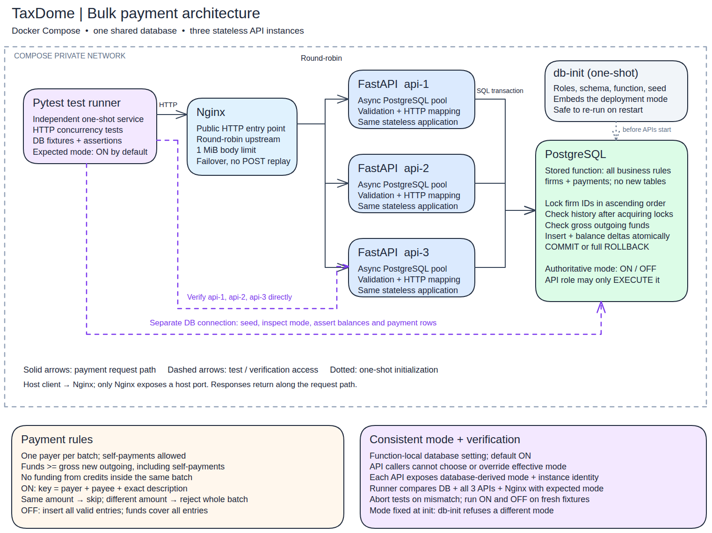

# TaxDome Firm Payments — bulk payment service

A web service that receives a bulk payment request from one firm, checks that the firm's balance
covers every payment in it, and then applies all of them atomically or none of them. It runs as
three identical FastAPI instances behind Nginx, and PostgreSQL is the single source of truth.

> **Reviewer TL;DR**
> ```bash
> scripts/up.sh                 # build + start postgres, db-init, api-1..3, nginx (http://localhost:8080)
> scripts/sample.sh             # POST the official three-payment sample -> 201
> scripts/db-state.sh           # show firms, payments, total and the installed mode
> scripts/test.sh all           # full suite in fresh ON and OFF stacks + restart check
> scripts/down.sh               # stop (data volume is kept)
> ```
> Prerequisites: Docker Engine with the Compose v2 plugin. Python and PostgreSQL are not needed on the host.

[](docs/architecture.png)

*Architecture diagram ([PNG](docs/architecture.png), editable [Excalidraw source](docs/architecture.excalidraw), notes in [docs/architecture.md](docs/architecture.md)).*

## Contents

- [Solution overview](#solution-overview)
- [Assumptions](#assumptions)
- [Why it is safe under concurrency](#why-it-is-safe-under-concurrency)
- [Conditional idempotency (ON/OFF) and its limitation](#conditional-idempotency-onoff-and-its-limitation)
- [HTTP API](#http-api)
- [Running it](#running-it)
- [Verification and test results](#verification-and-test-results)
- [Problems encountered](#problems-encountered)
- [Possible improvements](#possible-improvements)
- [How I worked: AI tools and history](#how-i-worked-ai-tools-and-history)
- [Repository layout](#repository-layout)
- [Two quick questions](#two-quick-questions)

## Solution overview

The request path is shown in the [architecture diagram](#taxdome-firm-payments--bulk-payment-service) above.

1. **API (FastAPI, `app/`)** reads the raw body (capped at 1 MiB while streaming) and checks
   the media type. It decodes strict UTF-8 JSON and rejects a BOM, duplicate member names and
   `NaN`/`Infinity`. A strict Pydantic model (no coercion, no unknown fields) validates the shape
   and fields, and amount strings become **integer cents** using integer arithmetic only.
2. The API opens one `READ COMMITTED` transaction and makes **one call** to the stored function
   `app.process_payment_batch(payer_uuid, entries)`. If the call succeeds, it sends `COMMIT` and
   only then returns `201`. No ORM is used.
3. **The stored function (`db/02_function.sql`) is the only writer.** It validates its input
   again, resolves UUIDs, locks rows and checks funds. It then inserts payments and applies
   per-firm balance deltas. Any error rolls back the whole batch.
4. **`db-init`** (`app/migrate.py`) runs once before the APIs start. It creates roles, schema,
   function, privileges and the seed in one transaction, and it is idempotent. Restarting never
   reseeds or changes data.
5. **Privileges:** everything is owned by the NOLOGIN role `payments_owner`. The function is
   `SECURITY DEFINER` with a pinned `search_path`. The API's login role `payments_api` can only
   `EXECUTE` the function. It cannot read or write tables, create objects, or change the
   function or its mode.

The supplied tables are unchanged (`firms`, `payments` with exactly the given columns and
`INTEGER` types), in schema `app`. I added only integrity constraints (primary keys, foreign
keys, a unique firm UUID, positive amounts, non-negative balances) and a **non-unique** lookup
index on `(payer_firm_id, payee_firm_id, description COLLATE "C")`.

## Assumptions

Assumptions from the challenge's open points, settled in [`docs/PRD.md`](docs/PRD.md) §15:

- One payer per batch. A firm may pay itself: a row is recorded with zero net balance change,
  but the gross amount still has to be covered. Credits arriving in the same batch cannot fund
  it. Credits committed by other transactions before our locks are granted can.
- Empty and whitespace-only descriptions are allowed and kept exactly. Firm UUIDs are matched
  case-insensitively.
- Amounts are limited to the supplied `INTEGER` column (≤ $21,474,836.47 per payment and per
  balance). Sums use `bigint`.
- Firms are seeded; there is no firm management API and no other writer during traffic.
- The idempotency mode is fixed per deployment (see
  [Conditional idempotency](#conditional-idempotency-onoff-and-its-limitation)). There is no authentication, by scope decision:
  any caller can spend any firm's balance. A real deployment must authenticate the payer.
- The official seed is loaded only into an empty `firms` table.

## Why it is safe under concurrency

The service runs as several load-balanced instances, so correctness cannot depend on anything
in process memory. It relies only on PostgreSQL row locks:

- **Lock every participant, in one global order.** Before any write, the function takes
  `SELECT … FOR UPDATE` on every distinct firm in the batch (payer and all payees), one row per
  statement, in **ascending `firms.id`**. Every transaction acquires locks in the same order, so
  two batches can never wait on each other in a cycle. Reciprocal (A→B / B→A) and cyclic
  (A→B→C→A) transfers cannot deadlock.
- **Check funds only after the locks are held.** The payer's balance and the payment history
  are read in statements that run *after* the locks are granted. Under `READ COMMITTED` each
  statement takes a fresh snapshot, and the function is `VOLATILE`, so these reads see everything
  committed before the locks were granted. A competing debit can therefore never pass the funds
  check against an outdated balance.
- **All batches for one payer run one at a time.** Two batches from the same payer always
  conflict on the payer row. Duplicate detection is therefore race-free even for a payment key
  that has no row yet, so no unique constraint is needed.
- **Unrelated firms are not blocked.** Batches with disjoint sets of firms never touch the same
  rows and run in parallel. There is no table lock, application mutex or distributed lock.
- **Bounded waits.** Each transaction sets `lock_timeout` (default 5 s) and `statement_timeout`
  (15 s), and the pool waits at most 5 s for a connection. A timeout is reported as `503`, never
  `201`.
- **Money conservation.** The function computes balance changes from exactly the set of rows it
  inserts, in `bigint`, and range-checks them before the first write. Opening balances are kept;
  balances are never rebuilt from the payments table.

Tests prove each point with real overlap across `api-1..3`, not with mocks. As a check that the
tests have teeth, I removed `FOR UPDATE` from the function and four concurrency tests failed:
overspend, the 200-request flood and the duplicate race.

## Conditional idempotency (ON/OFF) and its limitation

The challenge has no request IDs, but clients retry. A **deployment-wide mode** decides what
happens when the same payment arrives twice. A payment's key is
**`(payer, payee, exact description)`**; the amount is *not* part of the key.

| Situation | ON (default) | OFF |
| --- | --- | --- |
| Key never seen before | insert | insert |
| Key seen before with an equal amount | **skip** (no row, no balance change) | insert again |
| Key seen before with a different amount | **reject the whole batch, 409** | insert |
| Equal repeats inside one batch | first is inserted, the rest skipped | all inserted |
| Funds required | sum of entries actually inserted | sum of all entries |

An ON batch in which every entry is a repeat returns `201` with `inserted_count: 0`, even if the
payer has no money left.

> ⚠️ **Limitation, please read:** in ON mode, two *intended* payments with the same payer, payee,
> description **and amount** are indistinguishable from a retry, so the second is skipped. Clients
> must use a distinct description (e.g. include an invoice number or a period) for every separate
> obligation. OFF mode never skips anything, but then a retried request **pays twice** if the
> first attempt committed and its response was lost. Neither mode gives exactly-once delivery.

**There is one mode, held in the database.** `PAYMENT_IDEMPOTENCY_MODE` (`on`/`off`, default
`on`) is read **only by `db-init`**. It stores the mode in the function's own configuration
(`ALTER FUNCTION … SET app.payment_idempotency = 'on'`). A function-local setting overrides
whatever a caller sets in its session, and only the owner can change it. API instances never read
a mode from their environment. `/diagnostics` reports the mode from `pg_proc` metadata of the
exact function signature. If you restart with a mode different from the installed one, `db-init`
exits with code 3 rather than reinterpret existing history. To change mode, use a fresh database.

## HTTP API

OpenAPI: `http://localhost:8080/openapi.json` (Swagger UI at `/docs`).

### `POST /payments/batch`

```json
{
  "payer_firm_uuid": "3f1c9a2e-7b4d-4c1e-9a55-2d8e6f0b7c41",
  "payments": [
    {"amount": "1200.75", "payee_firm_uuid": "8b2e4c71-0d3a-4f6e-b1c9-5a7d2e9f4c10", "description": "Bookkeeping cleanup, 3 clients"}
  ]
}
```

A `201` is returned only after the commit succeeds:

```json
{"inserted_count": 1, "skipped_count": 0, "gross_outgoing_cents": 120075, "idempotency_mode": "on"}
```

`gross_outgoing_cents` is the sum of newly inserted entries, self-payments included. It is not
the net change to the payer's balance.

Input rules:

| Field | Rule |
| --- | --- |
| `amount` | String matching `[0-9]+(\.[0-9]{1,2})?`, ≤ 32 chars, 1 … 2147483647 cents. `"25"`, `"25.0"` and `"25.00"` are equal; leading zeros are fine. Rejected: signs, spaces, exponents, commas, symbols, non-ASCII digits, numbers sent as JSON numbers, zero. |
| UUIDs | Hyphenated 8-4-4-4-12 hex, any letter case (looked up in lowercase). Rejected: braces, URNs, whitespace, integer IDs. |
| `description` | String of 0 – 1024 code points, stored exactly (no trimming or normalization). U+0000 and lone surrogates are rejected. |
| batch | 1 – 1000 entries; the same payee may appear more than once; a firm may pay itself. |
| body | ≤ 1 MiB; `Content-Type: application/json` (optional `charset=utf-8`); unknown attributes are rejected at every level. |

Errors use one envelope: `{"error": {"code": "...", "message": "...", "details": [...]}}`.
`details`, when present, lists `index` (entry position) and `path`.

| HTTP | `code` | When |
| --- | --- | --- |
| 400 | `invalid_json` | empty body, malformed JSON, duplicate member names, BOM, invalid UTF-8 |
| 413 | `request_too_large` | body > 1 MiB (from Nginx or the API) |
| 415 | `unsupported_media_type` | missing or non-JSON `Content-Type`, non-UTF-8 charset |
| 422 | `validation_error` | shape, type, limits, UUID or amount format |
| 422 | `unknown_firm` | a valid UUID that does not exist (payer or any payee) |
| 422 | `insufficient_funds` | locked payer balance < gross new outgoing |
| 422 | `numeric_overflow` | a resulting balance would exceed 2147483647 cents |
| 409 | `payment_amount_conflict` | ON mode: a key exists (or repeats in the batch) with another amount |
| 503 | `temporarily_unavailable` | pool exhausted, lock/statement timeout, DB down, missing mode; **nothing was applied** |
| 503 | `commit_outcome_unknown` | the connection dropped during `COMMIT`; the batch **may** have been applied |
| 500 | `internal_error` | unexpected failure; the transaction is rolled back |
| 404 / 405 | `not_found` / `method_not_allowed` | unknown route / method |

Checks run in this order: bytes/media/JSON → all field validation → firm existence → ON-mode
conflicts → funds → balance range → writes → commit. Nginx itself may return 502/504 if no API
answers. If an instance cannot be reached, Nginx tries the next one
(`proxy_next_upstream error timeout`). It never sends a POST to a second instance once any part
of it reached the first (no `non_idempotent`), so a payment is never submitted twice by the
proxy.

Diagnostics: `GET /health/live` (no DB access), `GET /health/ready` and `GET /diagnostics` (200
with `instance_id` and `idempotency_mode`, or 503). Each request writes one JSON log line with
correlation ID, instance, status, error code, elapsed time, mode and counts. Bodies and
descriptions are never logged. `X-Request-ID` is passed through or generated, and returned in
the response.

## Running it

```bash
cp .env.example .env            # optional: passwords, mode, HTTP_PORT
scripts/up.sh                   # docker compose up -d --build --wait
scripts/sample.sh               # official sample; or: scripts/sample.sh examples/intro.json
scripts/db-state.sh             # firms, payments, total balance, installed mode
curl -s localhost:8080/diagnostics
scripts/down.sh                 # stop; the pgdata volume (balances and payments) is kept
docker compose down -v          # only if you really want to wipe the normal stack's data
```

On a fresh volume the official sample returns
`{"inserted_count":3,"skipped_count":0,"gross_outgoing_cents":1325125,...}`. Balances become
Pinecrest **3,674,875**, Lopez **170,075** and Nair **1,405,050** cents (total 5,250,000).
Re-sending it in ON mode returns `inserted_count: 0, skipped_count: 3`. In OFF mode it pays
again, and the next one fails with `insufficient_funds`.

**OFF mode** needs a fresh database: `docker compose down -v && PAYMENT_IDEMPOTENCY_MODE=off scripts/up.sh`.

## Verification and test results

`scripts/test.sh all` does the following:

1. For each mode, starts a **separate disposable Compose project** (`taxdome-test-on`, then
   `taxdome-test-off`). ON runs with the variable unset to prove the default. Test stacks publish
   no host ports and use shorter resource waits (pool 2 s, lock 2 s, statement 4 s) so timeout
   cases finish quickly.
2. Runs the **independent test runner** container. It uses real PostgreSQL, real HTTP through
   Nginx, direct calls to `api-1..3`, and its own superuser DB connection for fixtures and
   assertions.
3. Before any payment test, checks that the expected mode (`EXPECTED_IDEMPOTENCY_MODE`) matches
   the database function metadata, each API directly and Nginx, including instance identity.
   It then reruns the runner with the *opposite* expectation and requires it to abort with exit 3.
4. Writes JUnit XML with case IDs and mode as properties to `evidence/test-results/`.
5. Runs `scripts/verify-restart.sh`: sample → snapshot → `down` (volume kept) → `up` with
   `db-init` re-run → identical balances, rows and mode.
6. Removes the test projects. It never touches the normal stack's volume
   (`scripts/reset-test.sh` cleans up leftovers).

`uv run pytest tests/unit` runs the unit tests on the host without Docker.

**Coverage.** All **151** active scenarios in
[`docs/Firm_Payments_Test_Scenarios.md`](docs/Firm_Payments_Test_Scenarios.md) are mapped to
tests via `@pytest.mark.case("ID")`. `tests/unit/test_catalogue_coverage.py` fails if an ID is
missing or unknown. Equivalent inputs are parametrized instead of duplicated. Overlap is forced
deterministically: a test-only hook inside the function blocks on an advisory lock at a named
stage, and the runner watches `pg_stat_activity` until requests are actually waiting. Sleeps are
never used as evidence. The same hook injects failures after validation, after locking, after
the payer's balance update, after a payee's update, between balance updates and inserts, after
the first insert, and before commit. Each failure must leave rows and balances unchanged.

**Latest results** (clean checkout, `scripts/test.sh all`):

| Mode | Result |
| --- | --- |
| ON (default) | 499 passed (192 unit + 307 integration) |
| OFF | 499 passed |
| Mode-mismatch runner | aborted with exit 3 in both modes, as required |
| Restart check | balances, payments and mode preserved |

The full suite takes about 70 s per mode. JUnit files are committed in `evidence/test-results/`.

About the test-only hook: production installs `app.test_hook(stage, payer_id)` as an empty
function owned by `payments_owner`, with no `EXECUTE` for anyone else. Only the disposable test
database replaces its body. The API has no test switches or routes.

## Problems encountered

- **PostgreSQL 18 refused `ALTER FUNCTION … SET app.payment_idempotency` from the
  non-superuser owner** ("permission denied to set parameter"). The function is still created
  by `payments_owner`, so `SECURITY DEFINER` runs without superuser rights. `db-init` then
  attaches the mode as the superuser. Callers still cannot override it: the
  session-override test confirms this.
- **My first test gate serialized the requests it was meant to overlap.** The hook took an
  *exclusive* transaction-level advisory lock, so after release the requests ran one at a time.
  A *shared* lock lets them proceed together.
- **Nginx overwrote a client's `X-Request-ID`** with its own ID. A `map` now keeps a supplied ID
  and generates one only when it is missing.
- **`jsonb` reorders object keys**, so the response fields came back in an odd order. The API
  now emits them in the documented order.
- A Pydantic `AfterValidator` already turned the amount into cents, and the code converted it a
  second time. The unit tests caught this before any integration run.
- Docker was not installed on the development VM. Docker Engine 29.9.2 / Compose 5.6.1 were
  installed.

## Possible improvements

- **Real idempotency keys** (an `Idempotency-Key` header plus a stored response) would remove the
  ON-mode limitation. That needs a new table, which the challenge's fixed schema excludes.
- Authentication and authorization (the payer must be the caller's firm).
- A balance and history read API; a ledger with opening-balance entries so balances can be
  audited from history.
- Metrics (latency, lock waits, 409/422 rates) and tracing. Today there are only structured logs.
- Load testing for capacity planning. Payments per payer are serialized by design, so a single
  very hot payer is throughput-bound.
- PgBouncer in transaction mode, a migration tool such as Alembic or sqitch, and high
  availability for PostgreSQL.
- `BIGINT` money columns if amounts above $21M are possible.

## How I worked: AI tools and history

- **Claude Code** (Anthropic CLI agent, model Claude Opus 5.5) with the *superpowers* skills
  plugin. It created this repository, installed Docker, wrote the implementation plan
  ([`docs/superpowers/plans/`](docs/superpowers/plans/2026-10-29-bulk-firm-payments.md)) from the
  PRD, and implemented it task by task with test-driven development: a failing test first, then
  the code, then the suite in both modes. A final whole-branch code review followed.
- **Earlier AI chats** produced the specification package in [`docs/`](docs/README.md): the
  challenge analysis and Russian translation, the PostgreSQL locking discussion and the
  architecture discussion. Their available history snapshots are in `docs/sources/conversations/`.
  As `docs/README.md` explains, these are tool-returned snapshots, not certified complete
  exports.
- The unedited Claude Code session transcript is to be exported by the repository owner into
  [`evidence/ai-logs/`](evidence/README.md). See that file for status.
- Commit history: one commit per plan task on branch `feat/bulk-payments` (`git log --oneline`).

## Repository layout

```
app/            FastAPI app, strict request parsing, DB access, initializer (migrate.py)
db/             schema, stored function, privileges, seed (applied by db-init)
nginx/          nginx.conf (round-robin, 1 MiB limit, failover without POST replay)
tests/unit/     parsing, error mapping, settings, catalogue traceability (no Docker)
tests/integration/  runs inside the test-runner container
scripts/        up, down, sample, db-state, test, verify-restart, reset-test
examples/       sample.json (official 3-payment sample), intro.json (2-payment example)
docs/           PRD, architecture (+ .excalidraw/.png), test catalogue, sources, plan
evidence/       JUnit results, AI logs
```

Pinned versions: PostgreSQL 18.6, Nginx 1.29.8-alpine, Python 3.14.10-slim, uv 0.11.3,
FastAPI 0.162.0, Starlette 1.10.0, Pydantic 2.14.2, psycopg 3.3.6, psycopg-pool 3.3.3,
uvicorn 0.54.0, pytest 9.2.0, HTTPX 0.28.1 (lock file: `uv.lock`).

## Two quick questions

- **How much time did you spend on this task?** _Pending: to be answered by the author._
- **How proud are you of your work?** _Pending: to be answered by the author._
